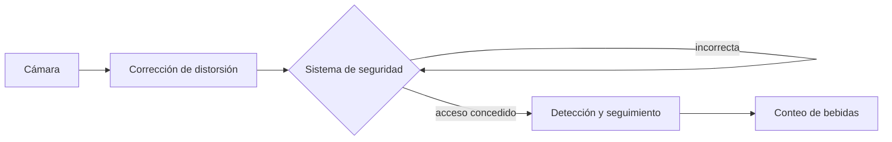

# Smart Inventory · Proyecto Final de Visión por Ordenador

Sistema en tiempo real que, tras **desbloquearse con una contraseña visual** (una secuencia de 4 figuras geométricas), **detecta, sigue y cuenta bebidas** que pasan por delante de la cámara.

Hecho en Python con **OpenCV** y **NumPy**, usando un móvil como webcam con **Iriun Webcam**.



## Estructura

```
proyecto_vision/
├── calibration/camera_params.npz   # parámetros de la cámara
├── calibration_chess_images/       # fotos del tablero de calibración
└── src/
    ├── main.py                     # programa principal: seguridad → detección
    ├── calibracion.py              # calibración de la cámara
    ├── sistema_seguridad.py        # contraseña con figuras geométricas
    ├── deteccion_objetos.py        # detección, seguimiento y conteo de bebidas
    └── test_camera.py              # prueba de conexión con la cámara
```

## Instalación

```bash
git clone https://github.com/CarlosdeMingo/proyecto_vision.git
cd proyecto_vision
pip install opencv-python numpy
```

Crea `src/contrasena.txt` con 4 figuras, una por línea (no se sube al repositorio). Figuras disponibles: `TRIANGULO`, `CUADRADO`, `PENTAGONO`, `HEXAGONO`, `CIRCULO`, `ESTRELLA`, `CRUZ`.

```
TRIANGULO
CIRCULO
ESTRELLA
CUADRADO
```

## Uso

Desde la raíz del proyecto:

```bash
python src/calibracion.py   # solo la primera vez
python src/main.py          # sistema completo
```

1. **Seguridad:** enseña las figuras de una en una dentro del recuadro verde, retirando la tarjeta entre figura y figura. `r` borra la secuencia y `q` sale.
2. **Fondo:** con la zona vacía, pulsa `ESPACIO`.
3. **Zona de paso:** márcala con el ratón y pulsa `ENTER`.
4. **Detección:** las bebidas (Coca-Cola, Nestea, Fanta, Agua) se cuentan al cruzar la línea amarilla. `q` sale y muestra el recuento final.

## Autores

- *Nombre Apellido*
- *Nombre Apellido*
